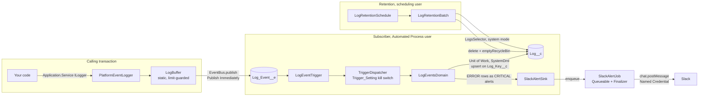

# apex-platform-logging

[](https://github.com/csquaredaz/apex-platform-logging/actions/workflows/ci.yml)


## The problem

Apex logging usually means `System.debug`, which no one sees unless a trace flag happens to be on, or log records inserted in the same transaction, which disappear when it rolls back. And a rollback is exactly when the log matters. A useful log has to survive the failure it describes. It also has to stay under governor limits so it can't break the code it watches, and it needs a bound on storage so it doesn't fill the org. When something breaks, a person should hear about it. This package plugs into the `ILogger` and `IAlertSink` ports of [apex-core-lib](https://github.com/csquaredaz/apex-core-lib):

- Entries go out as Publish Immediately Platform Events, so they survive a rollback.
- A subscriber persists them as `Log__c` rows.
- `ERROR` entries become Slack Block Kit alerts.
- A scheduled job deletes old rows.

The design is informed by production experience at scale.

## Architecture



Your code depends only on A's ports. `DI_Binding__mdt` rows bind `ILogger` to `PlatformEventLogger` and, once Slack is set up, `IAlertSink` to `SlackAlertSink`. Deactivate a row and A's defaults come back, with no deploy.

## Quick start

```bash
npm ci
npm run org:setup   # scratch org + apex-core-lib 1.1.0-1 + this repo + its permission sets
npm run org:test    # this repo's Apex tests with coverage
```

You need the Salesforce CLI and a default Dev Hub (`sf config set target-dev-hub=<alias>`). `org:test` runs this repo's `*Test` classes only. apex-core-lib has no namespace, so `RunLocalTests` would also run its packaged tests, and some of those assert defaults that this package overrides on purpose.

## Usage

From [`example/orders/classes/OrderConfirmationService.cls`](example/orders/classes/OrderConfirmationService.cls). The `example/` directory is compiled and tested in CI but never packaged.

```apex
ILogger logger = (ILogger) Application.Service.newInstance(ILogger.class);
logger.info('Confirming ' + orders.size() + ' order(s) for fulfilment');
try {
  IUnitOfWork unitOfWork = Application.UnitOfWork.newInstance(new List<SObjectType>{ Order.SObjectType });
  for (Order record : orders) {
    unitOfWork.registerDirty(new Order(Id = record.Id, Description = CONFIRMED_NOTE));
  }
  unitOfWork.commitWork();
} catch (DmlException failure) {
  logger.error('Order confirmation failed for ' + orders.size() + ' order(s)', failure);
  throw failure;
} finally {
  logger.flush();
}
```

When the update fails, the transaction rolls back, but both entries are still persisted and the ERROR raises one CRITICAL alert. `OrderConfirmationIntegrationTest` proves it with real DML and a real event bus. Write messages as attempts ("Confirming…"), not outcomes, because an entry is published even when the work it describes is rolled back.

The logger never throws. It flushes on `error()`, on `flush()` and when the buffer is full. It keeps the last 5 publish-immediate calls for your code, and anything it can't publish goes to the debug log.

## Setup

| Step                | What                                                                                                                                                                                                                                                                                               | Why                                                                                                                                                            |
| ------------------- | -------------------------------------------------------------------------------------------------------------------------------------------------------------------------------------------------------------------------------------------------------------------------------------------------- | -------------------------------------------------------------------------------------------------------------------------------------------------------------- |
| 1. Publishers       | Assign **`Log_Event_Publisher`** to every user whose code logs                                                                                                                                                                                                                                     | `EventBus.publish` checks Create on `Log_Event__e`, even from Apex ([ADR 0003](docs/adr/0003-publish-immediately.md)). Without it, entries go to the debug log |
| 2. Readers          | Assign **`Log_Viewer`** to the people who read logs                                                                                                                                                                                                                                                | `Log__c` is Private, and logs can quote sensitive data ([ADR 0005](docs/adr/0005-log-persistence.md))                                                          |
| 3. Level            | Set `Logging_Setting__mdt.Default`: `Minimum_Level__c` (`INFO` or above in production), `Buffer_Size__c` (default 50)                                                                                                                                                                              | Each entry is one event against the hourly allocation ([ADR 0002](docs/adr/0002-log-event-schema.md))                                                          |
| 4. Retention        | Optionally set `Retention_Days__c` (default 30). Assign yourself `Log_Event_Publisher`, then run `LogRetentionSchedule.schedule();` in anonymous Apex (daily at 02:00) or pass a cron expression                                                                                                   | Storage is the binding limit. An unlocked package can't schedule its own job at install ([ADR 0007](docs/adr/0007-log-retention.md))                           |
| 5. Slack (optional) | Create a Slack app with `chat:write` and set its bot token on External Credential **Slack**, principal `Slack_Bot`, parameter `Bot_Token`. Set `Slack_Channel__c`. Assign **`Slack_Alert_Sender`** and `Log_Event_Publisher` to the Automated Process user. Activate `DI_Binding.Slack_Alert_Sink` | The token never appears in source. The subscriber and its job run as Automated Process ([ADR 0006](docs/adr/0006-slack-alerts.md))                             |

**Kill switches**, none of which needs a deploy:

| To stop      | Do this                                                                                                                                                       |
| ------------ | ------------------------------------------------------------------------------------------------------------------------------------------------------------- |
| Logging      | Untick `Logging_Setting__mdt.Default.Is_Enabled__c`. Entries are dropped.                                                                                     |
| Persistence  | Add a `Trigger_Setting__mdt` row with `SObject_Type__c = Log_Event__e` and `Is_Active__c` unticked. Events published while it is off are not persisted later. |
| Slack alerts | Deactivate `DI_Binding.Slack_Alert_Sink`. Alerts go back to A's `NoOpAlertSink`.                                                                              |
| Retention    | Untick `Is_Retention_Enabled__c`. This stops a run in progress too. Or run `LogRetentionSchedule.unschedule();`.                                              |

## Design decisions

| Decision     | Choice                                                                                                   | Rejected alternative                                               | ADR                                                         |
| ------------ | -------------------------------------------------------------------------------------------------------- | ------------------------------------------------------------------ | ----------------------------------------------------------- |
| Distribution | Unlocked package, no namespace, depending on apex-core-lib                                               | Source-only; a module inside apex-core-lib                         | [0001](docs/adr/0001-apex-platform-logging-distribution.md) |
| Event schema | One `Log_Event__e` per entry, with typed fields                                                          | One event per flush carrying a JSON array                          | [0002](docs/adr/0002-log-event-schema.md)                   |
| Publish      | Publish Immediately, so entries survive a rollback                                                       | Publish After Commit (lost with the failure it describes)          | [0003](docs/adr/0003-publish-immediately.md)                |
| Buffer       | Static per-transaction buffer, flushed on error, size and demand, with a limit guard; never throws       | Publish per call; explicit flush only                              | [0004](docs/adr/0004-buffer-and-flush.md)                   |
| Persistence  | A domain via A's dispatcher, upserting on a log key through the Unit of Work, 3 retries, no self-logging | Direct `Database.upsert`; insert and ignore duplicates             | [0005](docs/adr/0005-log-persistence.md)                    |
| Alerts       | ERROR entries only, from the subscriber, as one Block Kit message per batch from a Queueable             | A synchronous callout; alerting from the logger (lost on rollback) | [0006](docs/adr/0006-slack-alerts.md)                       |
| Retention    | Scheduled batch, hard delete through the Unit of Work, one retention value, WARN-only failures           | Soft delete (crowds the Recycle Bin); a scheduled Flow             | [0007](docs/adr/0007-log-retention.md)                      |

**Deliberately omitted (free only, or not needed yet):**

- **Sampling.** `Minimum_Level__c` controls volume and retention bounds storage. Random sampling would drop exactly the entries needed to follow one request.
- **Per-user levels.** A hierarchy custom setting is the recorded extension point.
- **Archiving before deletion,** which needs a paid or external store.
- **Cross-transaction throttling of alerts.**
- **Calls to a real Slack workspace.** Slack is tested with `HttpCalloutMock` only; the first real post is a manual check after setup.

## Testing

| Layer                       | What it proves                                                                                                                                                                                      | Run it             |
| --------------------------- | --------------------------------------------------------------------------------------------------------------------------------------------------------------------------------------------------- | ------------------ |
| Apex unit (Stub API mocks)  | Buffering, flush triggers and fallbacks; the domain's mapping, retries and alerts; the Slack job's outcomes; retention's cutoff, kill switch and failure handling                                   | `npm run org:test` |
| Apex integration (real DML) | Events delivered with `Test.getEventBus().deliver()` and persisted; an entry surviving the caller's rollback; 200-row bulk cases; Minimum Access `runAs` users with and without the permission sets | `npm run org:test` |
| Example (real DML)          | A consumer's ERROR surviving its rollback and raising one alert                                                                                                                                     | `npm run org:test` |
| Static analysis             | Prettier, ESLint, Code Analyzer with zero High findings, gitleaks                                                                                                                                   | `npm run analyze`  |

CI runs the static checks on every PR. The scratch-org job runs on ready PRs and on `main`: it creates a scratch org, installs apex-core-lib, deploys, runs this repo's tests, gates on at least 90% coverage of this repo's classes, then deletes the org. A `main` run with the same code as a passing PR reuses the PR's result, which saves an org on a free Dev Hub.

## Built with Claude Code

- **Standards:** this repo's [`CLAUDE.md`](CLAUDE.md) and the [`apex-standards`](https://github.com/csquaredaz/claude-code-salesforce-skills) plugin (`apex-fflib-layers`, `apex-security`, `apex-testing`, `apex-code-review`). Rules that shaped this repo:
  - selectors own SOQL and a Unit of Work owns DML, which is why retention's hard delete goes through `registerWork` rather than a direct call
  - user mode unless an ADR says otherwise (two exceptions, in ADRs 0005 and 0007)
  - a 200-record bulk case and a least-privilege `runAs` test per feature
  - prove platform behaviour cheaply before spending a scratch org
- **One concrete example:** in PR #6 (retention), Claude Code planned the hard delete and probed the platform first with throwaway classes in a dev scratch org. The probe found that `Database.emptyRecycleBin` succeeds, yet `SELECT … ALL ROWS` keeps returning the rows with `IsDeleted = true` for minutes. A test asserting an empty Recycle Bin through SOQL would have failed for the wrong reason. The tests check that undelete fails with `UNDELETE_FAILED` instead. The same probe showed that a system-mode query in a `with sharing` class still applies sharing, which is why `LogsSelector` is a documented `without sharing` class. Both findings are recorded in [ADR 0007](docs/adr/0007-log-retention.md).
- **How AI work is reviewed:** every AI-assisted commit carries a `Co-Authored-By: Claude` trailer. Each one goes through a PR with CI, and every design trade-off is presented as options for a human decision before code is written. A human merges every PR.

## License

MIT
