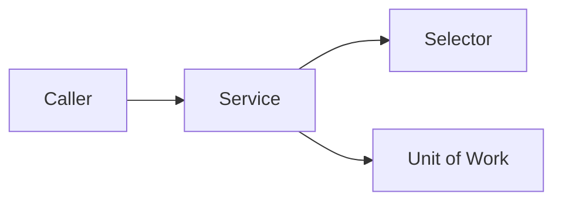

# apex-platform-logging

[](https://github.com/csquaredaz/apex-platform-logging/actions/workflows/ci.yml)


## The problem

<!-- One paragraph: the engineering problem this repo solves, who hits it, and why the obvious approach fails. The design may be described as "informed by production experience at scale" and nothing more specific. -->

## Architecture



## Quick start

```bash
npm ci
npm run org:setup
npm run org:test
```

Requires the Salesforce CLI and a Dev Hub set as the default (`sf config set target-dev-hub=<alias>`).

## Usage

```apex
// The shortest snippet that shows the public API doing its job.
```

## Design decisions

| Decision          | Choice          | Rejected alternative | ADR                       |
| ----------------- | --------------- | -------------------- | ------------------------- |
| <!-- decision --> | <!-- choice --> | <!-- alternative --> | [0001](docs/adr/0001-.md) |

## Testing

| Layer                       | What it proves                                        | Run it              |
| --------------------------- | ----------------------------------------------------- | ------------------- |
| Apex unit (Stub API mocks)  | Service and domain behaviour in isolation             | `npm run org:test`  |
| Apex integration (real DML) | Trigger → service → commit, as a least-privilege user | `npm run org:test`  |
| Static analysis             | Zero High or Critical Code Analyzer findings          | `npm run analyze`   |
| LWC (Jest)                  | Component behaviour                                   | `npm run test:unit` |

CI runs every layer on each PR in a fresh scratch org, then deletes the org.

## Built with Claude Code

- **Standards:** this repo's [`CLAUDE.md`](CLAUDE.md) and the [`apex-standards`](https://github.com/csquaredaz/claude-code-salesforce-skills) plugin (`apex-fflib-layers`, `apex-security`, `apex-testing`, `apex-code-review`).
- **One concrete example:** <!-- what Claude Code drafted, what the review caught or changed, and the commit or PR where it happened. -->
- **How AI work is reviewed:** every AI-assisted commit carries a `Co-Authored-By: Claude` trailer, goes through a PR with CI, and is reviewed against the same standards.

## License

MIT
